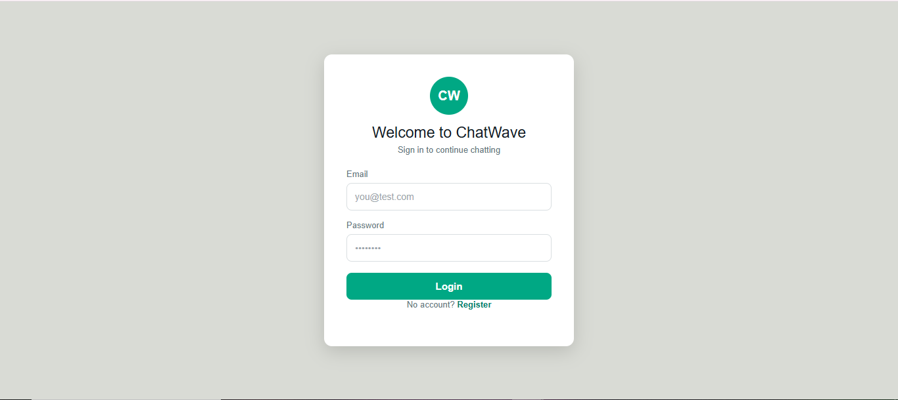
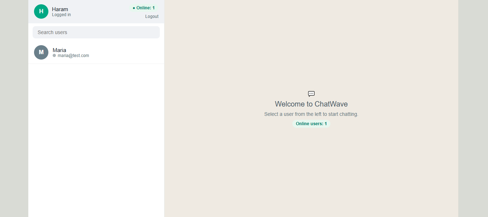
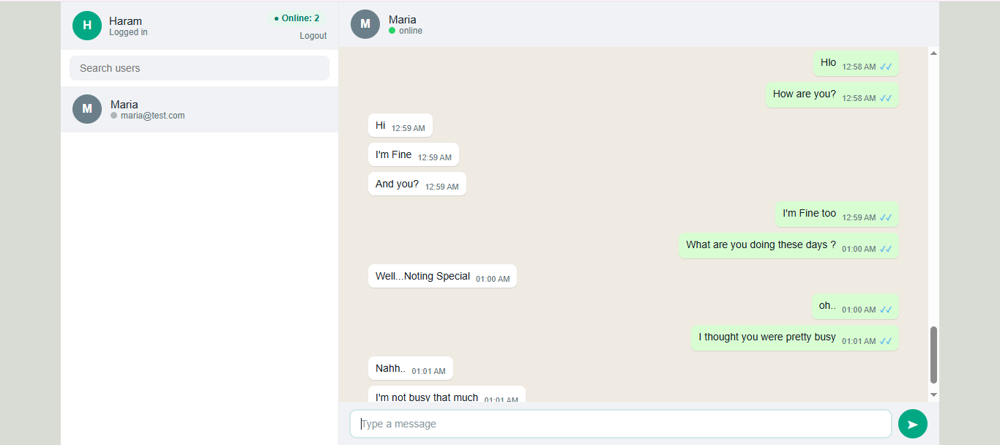
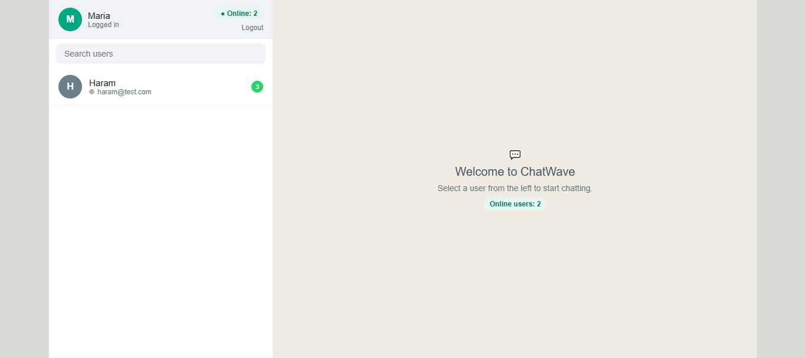
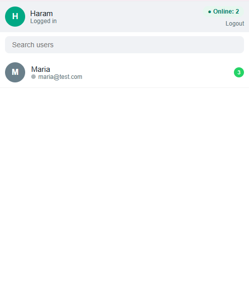
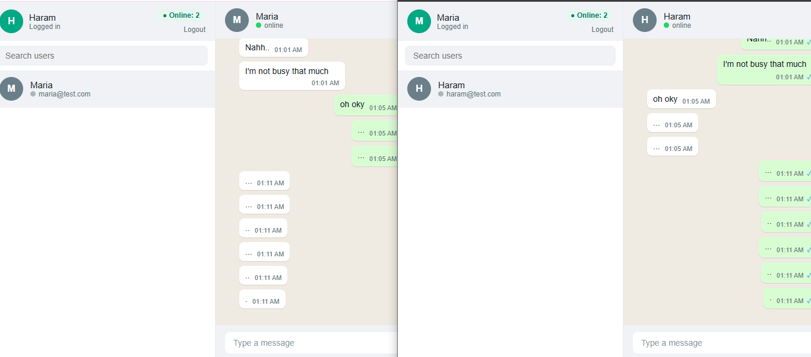

# ChatWave 💬

A real-time WhatsApp-style chat application built with the MERN stack and Socket.IO.

ChatWave allows users to register, log in securely, see other users, exchange real-time messages, track online users, receive unread-message notifications, see read receipts, and use a live typing indicator.

## ✨ Features

* 🔐 User registration and login
* 🍪 JWT authentication with httpOnly cookies
* 🛡️ Protected chat routes
* 👥 User list excluding the current user
* 💬 Real-time one-to-one messaging
* ⚡ Socket.IO real-time communication
* 🟢 Online user count
* 🔵 Read receipts with live blue ticks
* 🔔 Unread message badges
* ⌨️ Live typing indicator
* 📱 Responsive mobile layout
* 🕒 Message timestamps
* 📜 Persistent message history with MongoDB
* 🚪 Secure logout

## 🛠️ Tech Stack

### Frontend

* React
* Vite
* React Router
* Axios
* Socket.IO Client
* CSS

### Backend

* Node.js
* Express
* Socket.IO
* MongoDB
* Mongoose
* JWT
* Cookie-based authentication

## 📁 Project Structure

```text
chatwave/
├── client/
│   ├── src/
│   │   ├── components/
│   │   │   ├── ChatThread.jsx
│   │   │   └── UserList.jsx
│   │   ├── pages/
│   │   │   ├── Chat.jsx
│   │   │   ├── Login.jsx
│   │   │   └── Register.jsx
│   │   ├── api.js
│   │   ├── socket.js
│   │   ├── App.jsx
│   │   └── main.jsx
│   ├── package.json
│   └── vite.config.js
│
├── server/
│   ├── controllers/
│   ├── middleware/
│   ├── models/
│   │   ├── Message.js
│   │   └── User.js
│   ├── routes/
│   ├── socket.js
│   ├── index.js
│   └── package.json
│
├── screenshots/
├── .gitignore
└── README.md
```

## ⚙️ Getting Started

### Prerequisites

Make sure you have the following installed:

* Node.js
* npm
* MongoDB, either locally or through MongoDB Atlas
* Git

### 1. Clone the repository

```bash
 git clone https://github.com/haramabeera/chatwave.git
cd chatwave
```

### 2. Configure the server

```bash
cd server
```

Create a `.env` file based on `.env.example` and configure your environment variables.

Then install dependencies:

```bash
npm install
```

Start the backend:

```bash
npm run dev
```

The server runs on:

```text
http://localhost:3000
```

### 3. Configure the client

Open a new terminal:

```bash
cd client
```

Create a `.env` file based on `.env.example`.

Install dependencies:

```bash
npm install
```

Start the frontend:

```bash
npm run dev
```

The client runs on:

```text
http://localhost:5173
```

## 🔄 Real-Time Communication

ChatWave uses Socket.IO to provide real-time communication between connected users.

The application supports events for:

* Online user tracking
* Loading conversation history
* Sending messages
* Receiving messages instantly
* Tracking unread messages
* Marking messages as read
* Updating read receipts in real time
* Live typing indicators

Messages are stored in MongoDB so conversation history remains available after refreshing the application.

## 📸 Screenshots

### Login



### User List



### Chat



### Unread Messages



### Mobile Layout



### Two Users



## 🧪 Testing

To test real-time functionality:

1. Start MongoDB.
2. Start the server.
3. Start the client.
4. Open ChatWave in a normal browser window.
5. Open another browser window or incognito window.
6. Register two different users.
7. Log in with each user.
8. Send messages between the accounts.
9. Test unread badges, read receipts, online count, and typing indicators.

## 🔒 Security

The project uses:

* JWT authentication
* httpOnly cookies
* Protected routes
* Socket.IO authentication during the connection handshake
* Environment variables for sensitive configuration

`.env` files and `node_modules` are excluded from version control.

## 📌 Project Notes

ChatWave was developed as a full-stack real-time messaging application using the MERN ecosystem. The project demonstrates frontend state management, REST APIs, database persistence, authentication, responsive UI development, and real-time event-driven communication.

## 👩‍💻 Author

**Haram Abeera**

Built with React, Node.js, Express, MongoDB, and Socket.IO.
